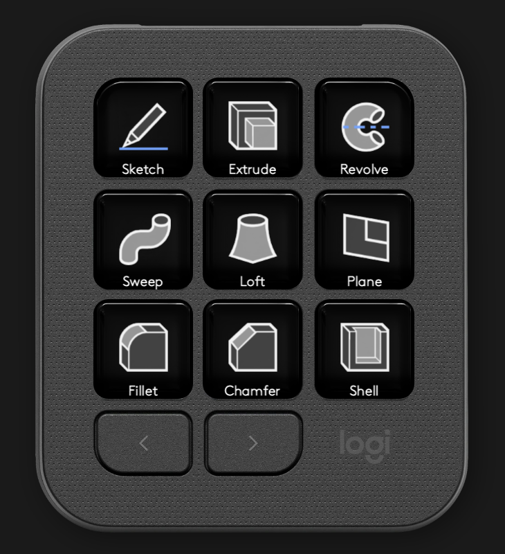

# Onshape MX Creative

Drive Onshape from a Logitech MX Creative Console — a Logi Options+ plugin plus the
Chrome extension it talks to.

Every toolbar tool is on offer, including the many Onshape has no keyboard shortcut
for — Chamfer, Shell, Loft, patterns, surfaces, sheet metal. And the keypad follows
what is on screen: open a sketch and it switches to sketch tools, open a feature
dialog and its keys become that dialog's options.



macOS only for now. Tested with Chrome 153, Logi Options+ 2.8 and Logi Plugin
Service 6.4 on macOS 27, Apple silicon.

MIT-licensed. The keys show Onshape's own icons, but none of them are in this
repository: the extension reads them out of the Onshape page you are signed in to.
See [NOTICE.md](NOTICE.md).

## How it works

```
MX Creative Console  ->  Logi Plugin Service  ->  Onshape plugin (C#)
                                                      |
                                        ws://127.0.0.1:47810 (JSON)
                                                      |
                                    Onshape MX Bridge (Chrome extension)
                                                      |
                                      content script on cad.onshape.com
```

Onshape has no API for driving its user interface, so the extension works the page
itself. Every button on Onshape's toolbar carries a `command-id` attribute —
`extrude`, `chamfer`, `CIRCLE_CENTER_RADIUS` — and pressing a key clicks that button,
opening its dropdown first when the tool lives in one. That is why tools without a
shortcut work exactly like the ones with one.

The extension also reports what the toolbar shows: which tools it holds (the sketch
toolbar has a line tool, the Part Studio toolbar has "new sketch"), which one is
running, and the parameters of any open feature dialog. The plugin switches the
console to the matching layout and lights up the running tool.

A plugin cannot listen on a web page, and a page cannot open a socket to localhost
without Chrome asking for local network access, so the extension's service worker is
the link: the plugin runs a WebSocket server on loopback and the worker dials in. The
server only accepts connections from a `chrome-extension://` origin.

When the extension is not running, keys that have an Onshape shortcut send it as a
keystroke instead. You lose everything that has no shortcut, and the state on the
keys, not the basics.

## Install

Paste this into Terminal:

```bash
curl -fsSL https://raw.githubusercontent.com/xfanta/onshape-mx/main/install.sh | sh
```

[`install.sh`](install.sh) downloads the latest release, installs the Options+
plugin, unpacks the Chrome extension to `~/Library/Application Support/Onshape MX`
and opens Chrome's Extensions page with that folder on the clipboard. It checks that
Onshape is installed as a Chrome app and that the plugin loaded. Loading the
extension is the one step left to you — Chrome does not let a script do it — and
the script says how. To update, run it again; add `--reset-profile` to rebuild the
keypad layout from the defaults, dropping your own changes to it.

A downloaded `.command` file would save opening Terminal, but macOS refuses to run
an unsigned one on a double-click, which is worse.

The rest of this section is what the script does, for doing it by hand. Both files
are in the [latest release](https://github.com/xfanta/onshape-mx/releases/latest):

* [`Onshape.lplug4`](https://github.com/xfanta/onshape-mx/releases/latest/download/Onshape.lplug4) — the Options+ plugin
* [`onshape-mx-bridge.zip`](https://github.com/xfanta/onshape-mx/releases/latest/download/onshape-mx-bridge.zip) — the Chrome extension

They are also in `dist/` if you cloned the repository; `install.sh` run from that
folder uses them instead of downloading.

### 1. Onshape as a Chrome app

Options+ picks a profile by the application in front, and Chrome is one application
however many tabs it has. Installed as an app, Onshape gets a window, a Dock icon and
an application identity of its own, so the console switches to Onshape only when
Onshape is in front.

In Chrome, open [cad.onshape.com](https://cad.onshape.com), then ⋮ → *Cast, save and
share* → *Install page as app…* (older Chrome: *More tools* → *Create shortcut…* with
*Open as window* ticked). The app lands in `~/Applications/Chrome Apps/`.

The plugin recognises the app by the start URL in its `Info.plist`, not by its
bundle id: Chrome derives that id from the URL, so it differs between installs.
Company domains (`yourcompany.onshape.com`) work the same.

### 2. The Chrome extension

Unzip `onshape-mx-bridge.zip` somewhere it can stay — Chrome loads an unpacked
extension from its folder every time — then in Chrome open `chrome://extensions`,
switch on *Developer mode* and choose *Load unpacked* on the `extension` folder.
Extensions run in installed-app windows too.

Reload any Onshape window that was already open (⌘R), so the extension gets into it.

### 3. The Options+ plugin

`logiplugintool install` hands off to the Options+ UI and fails from a terminal, so
unpack the package by hand:

```bash
PLUGINS=~/"Library/Application Support/Logi/LogiPluginService/Plugins"
rm -rf "$PLUGINS/Onshape"
mkdir -p "$PLUGINS/Onshape"
unzip -q Onshape.lplug4 -d "$PLUGINS/Onshape"
open "loupedeck://plugin/Onshape/reload"
```

The package ships default profiles, so the keypad comes populated. Default profiles
are only applied when a profile is *created*; if an Onshape profile already exists
from an earlier attempt, delete it in Options+ (three-dot menu beside the profile)
and add it again, or remove it on disk:

```bash
rm -rf ~/"Library/Application Support/Logi/LogiPluginService/Applications"/Loupedeck7*/@_onshape
```

To confirm everything is connected, look for `Onshape extension connected` in
`~/Library/Application Support/Logi/LogiPluginService/Logs/plugin_logs/Onshape.log`.

## What is on the keys

The keypad has a layout per situation, and switches between them by itself:

| Mode | When | Pages |
| --- | --- | --- |
| Part Studio | a Part Studio is open | **Create** · **Modify** · **View** |
| Sketch | a sketch is open | **Draw** · **Modify** · **Constrain** · **More** |
| Dialog | a feature dialog is open | **Options** · **More** |
| Assembly | an Assembly is open | **Mate** · **More** · **View** |

**Part Studio** — Create: Sketch, Extrude, Revolve / Sweep, Loft, Plane / Fillet,
Chamfer, Shell. Modify: Hole, Draft, Mirror / Linear and Circular pattern, Boolean /
Split, Transform, Move face. View: Front, Top, Iso / Fit, Normal to, Section /
Undo, Accept, Cancel.

**Sketch** — Draw: Line, Corner rectangle, Circle / 3-point arc, Tangent arc, Centre
rectangle / Construction, Dimension, Accept. Modify: Use, Offset, Trim / Fillet,
Mirror, Extend / Linear and Circular pattern, Undo. Constrain: Coincident,
Horizontal, Vertical / Parallel, Perpendicular, Tangent / Equal, Midpoint, Symmetric.
More: Slot, Polygon, Spline / Point, Text, 3-point circle / Fix, Concentric, Normal to.

**Dialog** — Accept, Cancel, then the open dialog's own options, read off the dialog
itself, so every feature works without a table of its own. For Extrude that is the
direction arrow, Solid | Surface | Thin, New | Add | Remove | Intersect, the end type
(Blind, Up to next, Through all…) and the checkboxes (Symmetric, Draft, Second end
position…). A key steps its option on — the next tab, the next dropdown entry, the
other state of a checkbox. The direction arrow always comes first, and keys stay put
while the dialog is open: options that appear later (Thin adds a second arrow) take
the next free key.

**Assembly** — Mate: Insert, Fastened, Revolute / Slider, Planar, Cylindrical / Mate
connector, Snap mode, Show mates. More: Pin slot, Ball, Parallel / Tangent, Width,
Group / Replicate, Linear pattern, Mirror.

Accept and Cancel press the dialog's own green check and red cross, which needs no
keyboard focus. In a sketch, Cancel leaves the running tool and never the sketch —
the sketch's red cross throws the whole sketch away.

The **Dialpad** has Undo, Redo, Accept and Cancel on its buttons. Its dials orbit and
zoom the view — except with a feature dialog open, when the first dial sets the
dialog's value: Extrude's depth, Fillet's radius, one unit (1 mm, 1°) per detent,
with the preview following. Pressing it moves on to the dialog's next number.

The rest is in Options+ under *All Actions → Installed Plugins → Onshape* to arrange
as you like:

| Group | Actions |
| --- | --- |
| Part Studio · Create | Sketch, Extrude, Revolve, Sweep, Loft, Thicken, Enclose, Rib, Hole, Thread, Plane, Mate connector |
| Part Studio · Modify | Fillet, Face blend, Chamfer, Draft, Body draft, Shell, Modify fillet, Delete / Move / Replace face, Boolean, Split, Delete part |
| Part Studio · Pattern & Transform | Linear, Circular and Curve pattern, Mirror, Transform, Wrap, Decal |
| Part Studio · Surfaces | Offset, Boundary, Fill, Move boundary, Ruled, Mutual trim, Constrained |
| Part Studio · Curves | Helix, 3D spline, Fit spline, Projected, Bridging, Composite, Intersection, Trim, Isocline, Offset, Isoparametric, Edit, Routing |
| Part Studio · Sheet Metal | Model, Flange, Hem, Tab, Bend, Jog, Form, Loft, Make joint, Corner, Bend relief, Corner break, Finish |
| Part Studio · Frames | Frame, Frame trim, Gusset, End cap, Cut list |
| Part Studio · Utilities | Variable, Query variable, Derived, Composite part, Tag |
| Sketch · Draw | Line, Midpoint line, three rectangles, two circles, Ellipse, four arcs, Conic, two polygons, Slot, Spline, Bezier, Spline point, Point, Text, Image, Construction |
| Sketch · Modify | Dimension, Use, Intersection, Fillet, Chamfer, Trim, Extend, Split, Offset, Mirror, Linear and Circular pattern, Transform, DXF/DWG |
| Sketch · Constraints | Coincident, Concentric, Parallel, Tangent, Horizontal, Vertical, Perpendicular, Equal, Midpoint, Normal, Pierce, Symmetric, Fix, Curvature |
| Assembly | Insert, eight mates, Tangent, Width, Group, four relations, Snap mode, Show mates, Replicate, Replace, patterns, Mirror, Display states, In-context Part Studio, Update references |
| Edit | Undo, Redo, Accept, Cancel, Deselect, Delete |
| View | Six views, Iso, Normal to, Fit, Zoom to selection, Section, Transparent, Hide, Show all, Isolate, Sketches, Planes, Named views, Measure, Search tools, Shortcut toolbar |
| Dialog | Dialog options 1–16, Dialog value (dial) |

Icons are Onshape's own, fetched from the page and cached in
`~/Library/Application Support/Logi/LogiPluginService/PluginData/Onshape/icons`.
Where Onshape has none — the standard views, Accept and Cancel, and the dialog
options it shows only as text — they are drawn here in the same style.

### Keyboard layouts

Onshape's view shortcuts are Shift+1 to Shift+7. On a Czech QWERTZ keyboard Shift+1
types "1", not "!", and the shortcut never fires. So the extension does not send a
keystroke: it replays the shortcut inside the page, spelled as a US keyboard would
spell it, whatever the system layout. Onshape accepts it.

The keystroke fallback without the extension does send real keys, and there the
layout does matter.

## Limitations

* **macOS and Chrome only.** The app detection reads Chrome's app shims on macOS; the
  extension is written for Chrome (Manifest V3).
* **Toolbar tools only.** A tool must be on Onshape's toolbar, in view or in one of
  its dropdowns. A tool you removed from the toolbar cannot be pressed.
* **Dialog option icons follow the English UI.** Tabs are recognised by value and
  work in any language; dropdown entries (Blind, Through all…) by label, so in another
  language they get a generic icon. They still work.
* **Onshape can change its page at any time.** Everything here rests on its
  `command-id` and `data-parameter-id` attributes. They have looked deliberate and
  stable, but they are not a published interface.

## Development

Logi Plugin Service 6.4 is built against **.NET 10**.

```bash
export DOTNET_ROOT="$HOME/.dotnet"
export PATH="$DOTNET_ROOT:$HOME/.dotnet/tools:$PATH"
export DOTNET_ROLL_FORWARD=LatestMajor   # logiplugintool itself targets .NET 8

cd OnshapePlugin && dotnet build
```

`dotnet build` drops `OnshapePlugin.link` into the Plugin Service's `Plugins` folder
pointing at its output. **A `.link` file wins over an installed package**, and every
build recreates it — including `-c Release` — so delete it before testing a real
`.lplug4` install.

After changing the extension, reload it in `chrome://extensions` and reload the
Onshape window: the old content script stays in an open page until it is reloaded.

### Layout

```
OnshapePlugin/src/
  OnshapePlugin.cs          plugin entry point: bridge, icons, mode switching
  OnshapeApplication.cs     recognises the Onshape Chrome app (and onshape.com URLs)
  Bridge/                   the WebSocket server and the page state
  Actions/                  buttons, one class per group; DialogCommand fills from dialogs
  Adjustments/              Dialpad dials
  Helpers/                  icon cache and recolouring
  Icons/                    the plugin's own icons (mx-*.svg)
  package/                  what ships: metadata, profiles
extension/
  background.js             service worker: relays between the plugin and the tabs
  content.js                reads the toolbar and dialogs, presses buttons
tools/                      generators, see below
```

### Protocol

JSON objects over the WebSocket, each with a `type`.

```
<- {"type": "state", "state": {"context": "partStudio", "active": ["extrude"], "dialog": true,
                                "form": {"title": "Extrude 1", "params": [...]}, ...}}
-> {"type": "run", "id": 7, "command": "chamfer"}
<- {"type": "result", "id": 7, "ok": true}
```

Requests: `run` (a toolbar tool; `mate#revolute` where buttons share a command-id),
`key` (replay a shortcut in the page), `dialog` (`ok` / `cancel`), `param` (step a
dialog option or number), `getIcons`, `discover` (list every tool the toolbar
offers, dropdowns included). The page sends `state` whenever the toolbar or the
dialog changes, and the plugin pings every 20 s to keep the service worker alive.

### Regenerating the assets

```bash
python3 tools/make_profiles.py       # package/profiles/DefaultProfile7*.lp5
python3 tools/make_option_icons.py   # Icons/mx-opt-*.svg
tools/make_dist.sh                   # dist/Onshape.lplug4 and dist/onshape-mx-bridge.zip
```

## Notes from reverse-engineering the SDK

The Blender plugin's [notes](https://github.com/xfanta/blender-mx-creative#notes-from-reverse-engineering-the-sdk)
on icon templates, SVG sizes and application icons all apply here. These are new.

### Actions load before the plugin does

The service creates every action and calls its `OnLoad` *before* it calls the
plugin's `Load`. Anything `Load` sets up is still null in an action's `OnLoad`, and an
exception there drops the action silently — no log line, it simply is not in
Options+. Whatever actions touch has to exist from the constructor, or be created
on first use.

### Switching modes is the plugin's job

`Plugin.SetCurrentMode` is virtual and the base implementation does nothing but
return `false`. The plugin has to find the mode and call `OnModeChanged(mode, null)`,
which stores it as `CurrentMode` and raises the `ModeChanged` event the service
listens to:

```csharp
public override Boolean SetCurrentMode(String modeName)
{
    var mode = this.GetMode(modeName);
    if (mode == null) return false;
    this.OnModeChanged(mode, null);
    return true;
}
```

Modes are added with `AddMode(new PluginMode(...))`; the built-in one is `main`. A
profile carries a layout per mode in `layout.layoutModes`, and the service swaps the
whole keypad when the mode changes. None of Logi's own plugins for this console use
modes, but the MX Creative Keypad honours them.

### VirtualKeyCode is not an enum

`VirtualKeyCode` is a class of named constants, so there is no `KeyA + n`. Look the
constant up by name.

### Recognising a Chrome app

Every Chrome app shim runs the same `app_mode_loader` executable under a bundle id of
`com.google.Chrome.app.<32 letters>`. Overriding
`IsProcessNameSupported(processName, processFilePath)` gets the executable's path,
and from it the app's `Info.plist`, whose `CrAppModeShortcutURL` says which site it
is. `ClientApplication` also has `IsBrowserUrlSupported(url)` for a site in a plain
browser tab.

### Enter accepts the feature

In an Onshape feature dialog, Enter commits the feature, even with focus in a number
field. The dialog value dial therefore commits a number the way leaving the field
does — `input`, `change`, `blur` — and never with Enter.

## Licence

**MIT** — see [LICENSE](LICENSE). [NOTICE.md](NOTICE.md) covers Onshape's icons and
logo.

Not affiliated with PTC, Onshape or Logitech.
